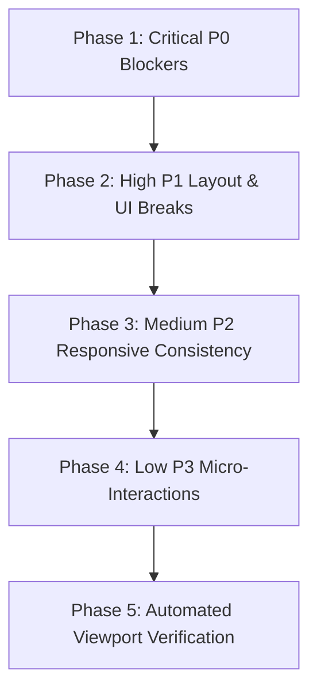

# Master Implementation Plan: Site-Wide UI, UX & CSS Defect Repair
**Target Platform:** HentaiKage (`hentaikage.cc` / `localhost:3004`)  
**Companion Audit:** [`SITE_WIDE_UI_UX_CSS_DEFECT_AUDIT.md`](file:///c:/new%20website%20creation/hentaianime/SITE_WIDE_UI_UX_CSS_DEFECT_AUDIT.md)  
**Execution Objective:** Surgically resolve all identified layout glitches, z-index collisions, responsive breakpoint disconnects, and aesthetic theme mismatches while strictly maintaining the **flat, modern, minimalist matte dark design**.

---

## 1. Plan Overview & Execution Strategy

The implementation is structured into **5 distinct phases**, prioritized strictly by severity and user impact:



### Safety & Style Principles
1. **Flat Minimalist Standard**: No multi-stop neon glowing gradients or 40px glow halos. Retain crisp flat borders (`rgba(255, 255, 255, 0.08)`), flat surfaces (`#121722`), and subtle transitions.
2. **Standardized Radii**:
   - Cards: `8px`
   - Inner buttons, inputs & filter pills: `6px`
   - Pill badges (ratings/tags): `9999px`
3. **No Layout Shifts**: All fixes must preserve zero-CLS (Cumulative Layout Shift) principles.

---

## 2. Phase-by-Phase Technical Specifications

---

### Phase 1: Critical (P0) Blockers

#### Task 1.1: Fix Cinema Mode / Lights Off Z-Index Piercing
- **Target File:** [`src/app/(public)/watch/[episodeId]/watch.module.css`](file:///c:/new%20website%20creation/hentaianime/src/app/(public)/watch/[episodeId]/watch.module.css)
- **Target Line(s):** Lines 17–24 (`.lightsOffDimmer`)
- **Root Cause:** `.lightsOffDimmer` has `z-index: 80`, whereas `.sidebar` has `z-index: 90` and `.header` has `z-index: 100`. The left sidebar and top navbar remain illuminated when cinema mode is active.
- **Implementation Steps:**
  1. Change `.lightsOffDimmer` `z-index` from `80` to `95`.
  2. In [`src/app/(public)/watch/[episodeId]/WatchPageClient.tsx`](file:///c:/new%20website%20creation/hentaianime/src/app/(public)/watch/[episodeId]/WatchPageClient.tsx), when `isLightsOff === true`, add a CSS utility class `body.cinemaModeActive` to `document.body` that reduces `.header` opacity to `0.08` and pointer-events to `none` while keeping the player container at `z-index: 96`.
  3. Keep the "Exit Lights Off" floating button at `z-index: 99`.
- **Validation Check:** Open `http://localhost:3004/watch/1/1`, click "Lights Off". Verify the top navbar and left sidebar dim to pitch black.

#### Task 1.2: Fix Tablet Breakpoint Disconnect on Watch Page (901px – 1024px)
- **Target File:** [`src/app/(public)/watch/[episodeId]/watch.module.css`](file:///c:/new%20website%20creation/hentaianime/src/app/(public)/watch/[episodeId]/watch.module.css)
- **Target Line(s):** Line 876 (`@media (max-width: 900px)`) & Line 1450 (`@media (max-width: 1024px)`)
- **Root Cause:** `.playerLayout` switches to single-column at `1024px`, but `.sidebarColDesktop` is not hidden until `900px`. At widths 901px–1024px, the sidebar is pushed under the player and expands to 100% width.
- **Implementation Steps:**
  1. Harmonize the breakpoint threshold: change `@media (max-width: 900px)` on line 876 to `@media (max-width: 1024px)`.
  2. Ensure `.mobileOnlyQueueCard` and `.mobileOnlySeriesQueueBlock` display at `<= 1024px`.
- **Validation Check:** Resize browser viewport between 901px and 1024px. Confirm the 360px sidebar does not stretch across the entire screen width.

---

### Phase 2: High Severity (P1) Layout & UI Breaks

#### Task 2.1: Implement Complete Responsive Mobile CSS for FAQ Page
- **Target File:** [`src/app/(public)/faq/faq.module.css`](file:///c:/new%20website%20creation/hentaianime/src/app/(public)/faq/faq.module.css)
- **Root Cause:** Zero media queries exist in `faq.module.css`. Container padding, title size (2.2rem), and question padding are completely unscaled on mobile devices.
- **Implementation Steps:**
  1. Add `@media (max-width: 768px)`:
     - `.container`: `padding: 0.85rem 1rem 3rem;`
     - `.header h1`: `font-size: 1.6rem;`
     - `.subtitle`: `font-size: 0.88rem;`
     - `.question`: `padding: 1rem 1.1rem; font-size: 0.98rem;`
     - `.answer`: `padding: 0 1.1rem 1rem; font-size: 0.9rem;`
  2. Add `@media (max-width: 480px)`:
     - `.header h1`: `font-size: 1.35rem;`
     - `.question`: `padding: 0.85rem 0.95rem; font-size: 0.92rem;`
     - `.answer`: `padding: 0 0.95rem 0.85rem; font-size: 0.85rem;`
- **Validation Check:** Navigate to `/faq` at 390px and 360px. Confirm headings fit neatly on two lines and accordion cards have clean edge spacing.

#### Task 2.2: Redesign 404 Not Found Page to Match Modern Flat Matte Aesthetic
- **Target File:** [`src/app/not-found.module.css`](file:///c:/new%20website%20creation/hentaianime/src/app/not-found.module.css)
- **Root Cause:** Legacy neon glowing purple-pink linear gradients, 16px radius, and 40px box-shadow glows clash with the flat matte dark UI.
- **Implementation Steps:**
  1. Replace `.card` styling:
     - `border-radius: 8px;`
     - `background: var(--surface, #121722);`
     - `border: 1px solid rgba(255, 255, 255, 0.08);`
     - `box-shadow: none;`
     - `backdrop-filter: none;`
  2. Replace `.codeBadge` gradient:
     - Remove `background: linear-gradient(...)` and `filter: drop-shadow(...)`.
     - Set color to `#ffffff` with a gold/amber accent outline or subtle badge pill (`#f59e0b`).
     - Set `font-size: clamp(3.5rem, 14vw, 5.5rem);` to avoid overflow on 320px screens.
  3. Replace search input focus ring to gold/amber: `border-color: rgba(245, 158, 11, 0.5); box-shadow: none;`.
- **Validation Check:** Navigate to `/this-does-not-exist` on desktop and mobile. Confirm page looks sleek, flat, and perfectly matches the main website.

#### Task 2.3: Series Detail Page Synopsis Gradient Fade Mask
- **Target File:** [`src/app/(public)/series/[slug]/series.module.css`](file:///c:/new%20website%20creation/hentaianime/src/app/(public)/series/[slug]/series.module.css)
- **Root Cause:** Truncated synopsis text is abruptly clipped midway through letters without a fade transition.
- **Implementation Steps:**
  1. In `series.module.css`, define `.synopsisCollapsed`:
     ```css
     .synopsisCollapsed {
       max-height: 4.8em;
       overflow: hidden;
       position: relative;
       -webkit-mask-image: linear-gradient(to bottom, rgba(0, 0, 0, 1) 50%, rgba(0, 0, 0, 0) 100%);
       mask-image: linear-gradient(to bottom, rgba(0, 0, 0, 1) 50%, rgba(0, 0, 0, 0) 100%);
     }
     ```
  2. Reduce mobile banner height in `@media (max-width: 680px)` from `300px` to `220px` to elevate the title and episode grid above the fold.
- **Validation Check:** Open any series page on desktop and mobile. Confirm truncated synopsis fades out smoothly into the "Read More" button.

#### Task 2.4: Equalize Studio Card Heights in Studios Directory
- **Target File:** [`src/components/StudiosDirectory/StudiosDirectoryClient.module.css`](file:///c:/new%20website%20creation/hentaianime/src/components/StudiosDirectory/StudiosDirectoryClient.module.css)
- **Root Cause:** Studios without founded years or descriptions collapse vertically, causing misaligned card bottoms.
- **Implementation Steps:**
  1. Add to `.studioCard`:
     ```css
     display: flex;
     flex-direction: column;
     height: 100%;
     ```
  2. Add `margin-top: auto;` to `.studioFooterMeta` so the release counts and founded badges pin consistently to the card bottom.
  3. Add `@media (max-width: 480px)` for compact padding and full-width search bar.
- **Validation Check:** View `/studios` on desktop. Verify all cards in any given grid row share identical bottom borders.

#### Task 2.5: Watch Page Mobile Action Bar Alignment
- **Target File:** [`src/app/(public)/watch/[episodeId]/watch.module.css`](file:///c:/new%20website%20creation/hentaianime/src/app/(public)/watch/[episodeId]/watch.module.css)
- **Root Cause:** Action buttons wrap into two misaligned rows on 390px screens.
- **Implementation Steps:**
  1. In `@media (max-width: 768px)`, structure `.playerActions`:
     ```css
     display: grid;
     grid-template-columns: repeat(4, 1fr);
     gap: 0.5rem;
     width: 100%;
     ```
  2. Center icons and make button labels compact (`font-size: 0.72rem`).
- **Validation Check:** View `/watch/1/1` in 390×844 mobile view. Confirm Favorite, Share, Download, and Report align in a single uniform row.

---

### Phase 3: Medium Severity (P2) Polish & Responsive Consistency

#### Task 3.1: Unify Filter Pill Radii on `/uncensored`
- **Target File:** [`src/app/(public)/uncensored/uncensored.module.css`](file:///c:/new%20website%20creation/hentaianime/src/app/(public)/uncensored/uncensored.module.css)
- **Implementation Steps:**
  1. Change `.filterPillActive` (line 107) `border-radius: 20px;` to `border-radius: 6px;` to match inactive `.filterPill` (line 86).
  2. Set `.filterPillsRow` on mobile (`max-width: 768px`) to horizontal swipe with `flex-wrap: nowrap; overflow-x: auto; scrollbar-width: none;`.

#### Task 3.2: Optimize Search Page Empty State Spacing
- **Target File:** [`src/app/(public)/search/search.module.css`](file:///c:/new%20website%20creation/hentaianime/src/app/(public)/search/search.module.css)
- **Implementation Steps:**
  1. In `@media (max-width: 600px)`, adjust `.emptyState`:
     - `padding: 2rem 1rem;`
     - `margin: 1.25rem auto;`
     - Reduce `.emptyIcon` from 48px to 36px.

#### Task 3.3: Smooth Touch Scrolling on Genres Alphabet Bar
- **Target File:** [`src/components/GenresDirectory/GenresDirectoryClient.module.css`](file:///c:/new%20website%20creation/hentaianime/src/components/GenresDirectory/GenresDirectoryClient.module.css)
- **Implementation Steps:**
  1. In `.alphabetBar`, add `-webkit-overflow-scrolling: touch;`.
  2. Change `scrollbar-width: thin;` to `scrollbar-width: none;` and add `display: none;` to `::-webkit-scrollbar` so letter pills swipe cleanly without an overlay track.
  3. Add `@media (max-width: 480px)` breakpoint scaling.

#### Task 3.4: Settings Page Mobile Padding Scalability
- **Target File:** [`src/app/(public)/settings/settings.module.css`](file:///c:/new%20website%20creation/hentaianime/src/app/(public)/settings/settings.module.css)
- **Implementation Steps:**
  1. Add `@media (max-width: 600px)`:
     - `.container`: `padding: 0.85rem 1rem 3rem;`
     - `.infoCard, .formCard`: `padding: 1.15rem 1rem;`
     - `.titleRow h1`: `font-size: 1.45rem;`
  2. Frees up over 60px of screen real estate for form inputs on phones.

#### Task 3.5: Login Page Centering & Focus Ring Alignment
- **Target File:** [`src/app/(public)/login/login.module.css`](file:///c:/new%20website%20creation/hentaianime/src/app/(public)/login/login.module.css)
- **Implementation Steps:**
  1. Update `.container` to `min-height: calc(100vh - 140px);`.
  2. Update `.input:focus` border color to match the subtle search bar ring `border-color: rgba(245, 158, 11, 0.45);`.
  3. Increase password toggle icon tap target to `44px × 44px`.

#### Task 3.6: Mobile Drawer Guest Card CTA Button Text
- **Target File:** [`src/components/Header/Header.module.css`](file:///c:/new%20website%20creation/hentaianime/src/components/Header/Header.module.css)
- **Implementation Steps:**
  1. Shorten label from "Create Free Account" to "Sign Up" or configure `white-space: nowrap; font-size: 0.82rem;` to prevent disjointed 2-line stacking on 360px screens.

---

### Phase 4: Low Severity (P3) Micro-Interactions & Aesthetics

#### Task 4.1: Footer A-Z Bar Mobile Swipe Experience
- **Target File:** [`src/components/Footer/Footer.module.css`](file:///c:/new%20website%20creation/hentaianime/src/components/Footer/Footer.module.css)
- **Implementation Steps:**
  1. In `@media (max-width: 640px)`, remove `flex-direction: column;` from `.azBar`.
  2. Keep `.azBar` inline with `.azList` horizontally scrollable (`flex-wrap: nowrap; overflow-x: auto; scrollbar-width: none;`).

#### Task 4.2: Top SEO Hero Header Mobile Readability
- **Target File:** [`src/app/(public)/page.module.css`](file:///c:/new%20website%20creation/hentaianime/src/app/(public)/page.module.css)
- **Implementation Steps:**
  1. In `@media (max-width: 768px)`, change `-webkit-line-clamp: 1` to `-webkit-line-clamp: 2` on `.seoHeroDescription`.

#### Task 4.3: Desktop Sidebar Collapsed Icon Mathematical Centering
- **Target File:** [`src/components/DesktopSidebar/DesktopSidebar.module.css`](file:///c:/new%20website%20creation/hentaianime/src/components/DesktopSidebar/DesktopSidebar.module.css)
- **Implementation Steps:**
  1. In `.collapsed .navItem`, add `justify-content: center; padding-left: 0; padding-right: 0;` to ensure strict pixel alignment inside the 76px container.

#### Task 4.4: Catalog Pre-Hydration Skeletons
- **Target File:** Section loading components & [`src/app/(public)/page.module.css`](file:///c:/new%20website%20creation/hentaianime/src/app/(public)/page.module.css)
- **Implementation Steps:**
  1. Replace pitch-black placeholder blocks with flat matte skeleton boxes (`rgba(255, 255, 255, 0.03)`) with a gentle 1.5s CSS pulse.

---

## 3. Phase 5: Automated Testing & Viewport Verification Protocol

Upon applying the changes, verify each viewport using our headless browser inspection script:

### Viewport Test Matrix

| Viewport Preset | Dimensions | Target Inspection Items |
| :--- | :---: | :--- |
| **Desktop Ultra** | `1920 × 1080` | Centering on `/login`, popover hover positioning on 6th column, cinema mode dimmer |
| **Desktop Standard** | `1440 × 900` | 76px sidebar collapse / 248px expand, watch player aspect ratio, hero carousel |
| **Tablet Landscape** | `1024 × 768` | **Watch Page**: Confirm 360px sidebar does NOT stretch to 100% width |
| **Tablet Portrait** | `768 × 1024` | Catalog grid 3-column switch, header hamburger icon visibility |
| **Mobile Standard** | `390 × 844` (iPhone 14/15/16) | Watch page 4-column action bar, series synopsis fade mask, FAQ headers |
| **Mobile Compact** | `360 × 800` (Android compact) | Settings form input width, mobile drawer CTA buttons, alphabet bar swipe |
| **Ultra Compact** | `320 × 568` (SE) | 404 code badge text clamp, zero horizontal scrollbar leaks |

---

## 4. Work Breakdown & Execution Readiness

| Phase | Tasks | Estimated Duration | Risk Level | Prerequisites |
| :---: | :---: | :---: | :---: | :---: |
| **Phase 1** | Tasks 1.1 – 1.2 | ~15 mins | Low | Dev server running (`localhost:3004`) |
| **Phase 2** | Tasks 2.1 – 2.5 | ~25 mins | Low | Phase 1 complete |
| **Phase 3** | Tasks 3.1 – 3.6 | ~20 mins | Very Low | Phase 2 complete |
| **Phase 4** | Tasks 4.1 – 4.4 | ~15 mins | Very Low | Phase 3 complete |
| **Phase 5** | Verification & Screenshots | ~15 mins | Zero | All phases complete |

---

*Plan formulated for review. Once approved, execution can begin immediately starting with Phase 1.*
